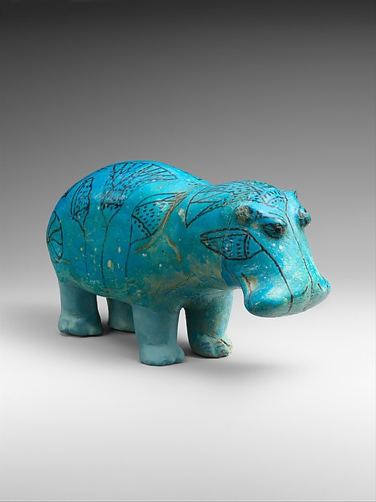
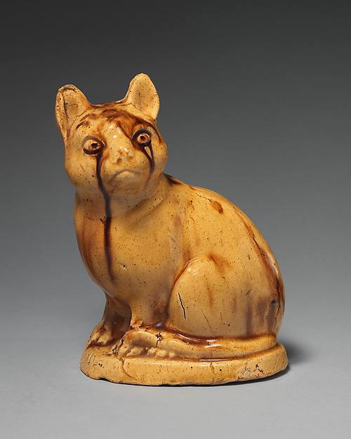
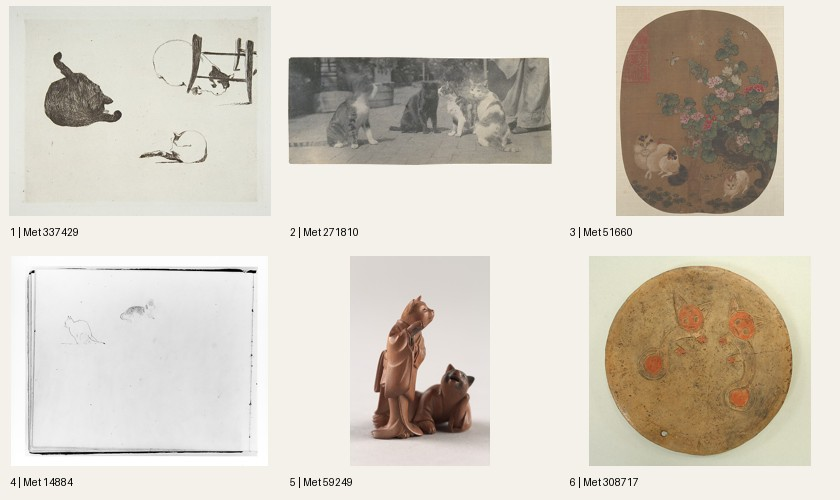

# Met Museum Codex Plugin

A Codex Skill Plugin for searching the Metropolitan Museum of Art collection,
viewing artwork images, and downloading references with catalog information.

Independent project, not affiliated with
or endorsed by The Metropolitan Museum of Art.

The plugin includes an agent skill and a Python script. It supports API and CSV
searches, metadata filtering, numbered contact sheets, and image downloads to a
specified folder. Results are saved locally and returned to the agent in pages.

<p>
  <a href="https://www.metmuseum.org/art/collection/search/544227"></a>
  <a href="https://www.metmuseum.org/art/collection/search/45434"></a>
  <a href="https://www.metmuseum.org/art/collection/search/191965"></a>
</p>

## Install in Codex

Requires Codex with local plugin support and Python 3.10+.

```sh
codex plugin marketplace add TheInnerParty/Met-Museum-Codex-Plugin
codex plugin add met-art-research@met-art-research
```

Alternatively, [download the plugin ZIP (v0.1.1)](https://github.com/TheInnerParty/Met-Museum-Codex-Plugin/releases/download/v0.1.1/met-art-research-0.1.1.zip),
extract it, and ask Codex to install the extracted folder as a local plugin.

Check installation with `codex plugin list`. Start a new chat if the plugin
does not appear in the current one.

## Command-line usage

See [runtime setup](met-art-research/skills/met-art-research/references/runtime.md) for dependencies.

Run the following commands from the `met-art-research` package directory inside
the repository:

```sh
python3 skills/met-art-research/scripts/met.py search "Cats" --scope title --has-images --max-ids 24
```

The response includes a `session` path. Substitute it below to retrieve catalog
records, browse works with images, and create a contact sheet:

```sh
python3 skills/met-art-research/scripts/met.py scan /returned/session/path --public-domain --has-images
python3 skills/met-art-research/scripts/met.py show /returned/session/path --selection
python3 skills/met-art-research/scripts/met.py contact-sheet --session /returned/session/path --selection --limit 6 --columns 3 --rows 2
```

Open the returned contact-sheet file to view the images. Example: six public-domain
results from the “Cats” title search.



To download originals:

```sh
python3 skills/met-art-research/scripts/met.py images 436535 45734 --size original --output-dir /absolute/path/to/references
```

The response includes absolute image paths and a manifest containing the catalog
details and source information for each download.

To search the full collection CSV:

```sh
python3 skills/met-art-research/scripts/met.py search "textile" --source csv
```

The CSV is downloaded once and cached locally. Matching records can be browsed
with `show`. Use the API to retrieve current records and image URLs.

API searches can retrieve up to 10,000 IDs per query. Each search reports its
coverage. Use CSV search for queries that exceed this limit.

See [the command reference](met-art-research/skills/met-art-research/references/commands.md) for
filters, paging, resuming, refresh, caching, and error behavior.

## Local files and data

Searches and catalog records are cached in `~/.cache/met-art-research`. Images can
be saved there or to a destination you specify. These files remain available until
you remove them; `--cache-dir` lets you choose a different cache location.

The script retrieves records and images from the Met and the collection CSV from
its GitHub repository. Those services receive HTTP connection information and,
for API searches, query parameters. The plugin collects no analytics or telemetry.

## Sources and attribution

Data comes from the [Met Collection API](https://metmuseum.github.io/) and the
[Open Access dataset](https://github.com/metmuseum/openaccess). Download manifests
preserve the Met's supplied attribution, credit, and rights information. Consult
the individual artwork record when choosing images for reuse.

[README image sources and credits](met-art-research/assets/readme/SOURCES.md).

## Development

```sh
python3 -m unittest discover -s tests -v
```

See [verification notes](met-art-research/VERIFICATION.md) for test coverage and live checks,
and [publication preparation](met-art-research/PUBLICATION.md) for the release checklist.
